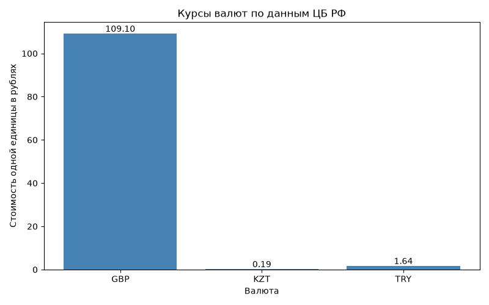

# Лабораторная работа «Работа с валютами. Шаблон „Одиночка“»

**Выполнила:** Полторацкая Анастасия, группа 2об_ПОО

## Описание работы

В данной лабораторной работе разработана программа на Python, которая получает актуальные курсы валют с сайта Центрального банка РФ.

Основная задача — применить объектно-ориентированный подход и реализовать паттерн проектирования **Singleton («Одиночка»)** с помощью метакласса.

## Реализация программы

В процессе выполнения работы были реализованы следующие возможности:

- Создан класс `CurrenciesLst` для получения и хранения информации о валютах.
- Реализован метакласс `SingletonMeta`, благодаря которому повторное создание `CurrenciesLst` возвращает уже существующий объект.
- Значения курсов сохраняются отдельно в виде целой и дробной частей.
- Для каждой валюты дополнительно сохраняется номинал.
- Добавлено ограничение частоты запросов к ЦБ РФ. По умолчанию между запросами выдерживается интервал в одну секунду.
- Разработан метод `visualize_currencies()`, который строит столбчатую диаграмму и сохраняет её в файл `currencies.jpg`.
- Написаны тесты для проверки правильных и неправильных идентификаторов валют, а также работы Singleton.

## Проверка работы

Для тестирования использовался модуль `unittest`.

Запуск тестов:

`python -m unittest test.py -v`

**Результат:** успешно пройдены 4 теста.

Проверена корректность получения курсов фунта стерлингов и казахстанского тенге, обработка неправильного ID и повторное использование одного экземпляра класса.

## Результат работы

Программа получает данные о валютах, выводит их в консоль и создаёт график стоимости одной единицы каждой валюты в рублях.

## Вывод

В ходе лабораторной работы я познакомилась с реализацией паттерна Singleton через метакласс, научилась получать и обрабатывать XML-данные, сохранять номиналы валют и строить графики с помощью библиотеки `matplotlib`.

Также закрепила навыки создания классов, работы с методами и написания автоматических тестов.